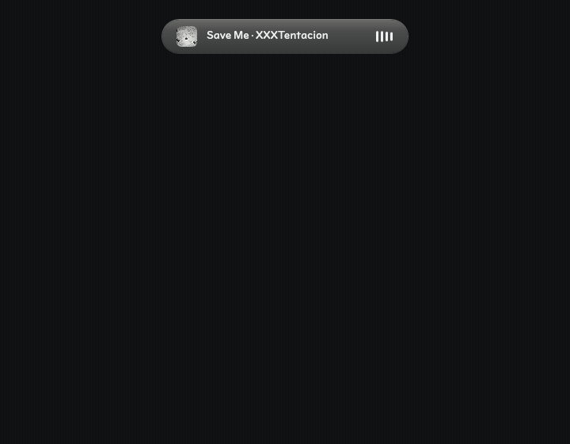
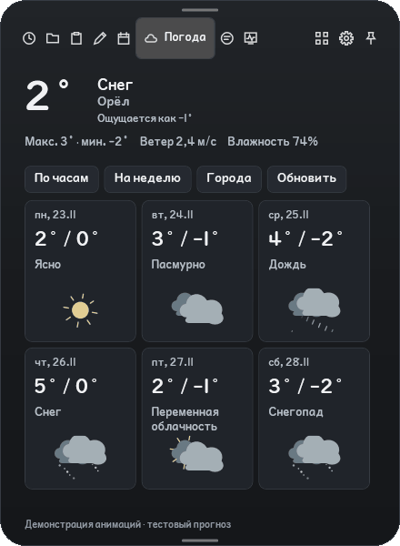
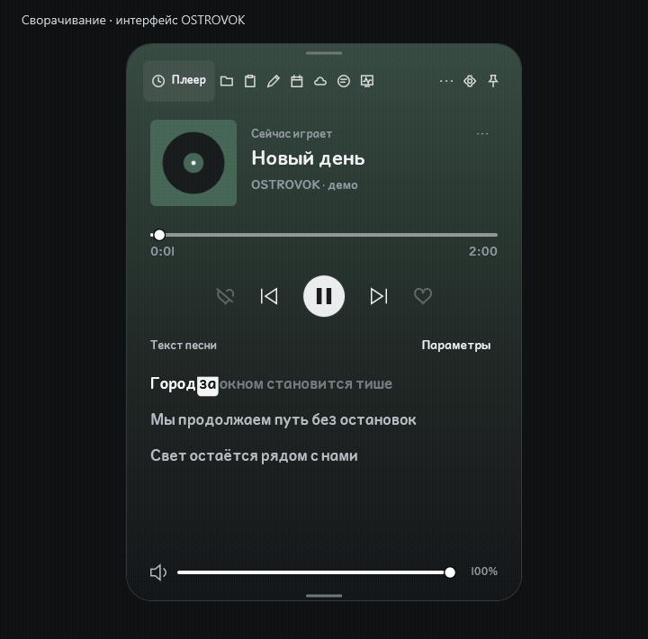
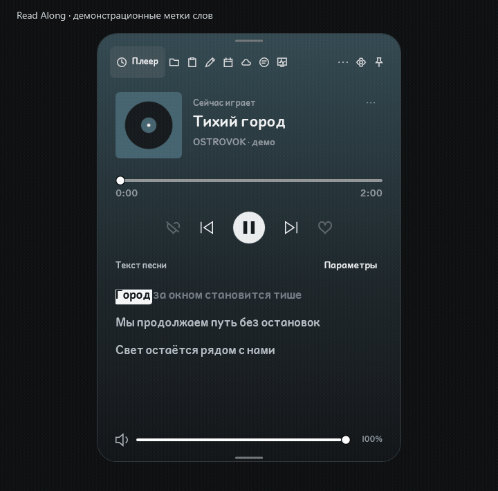
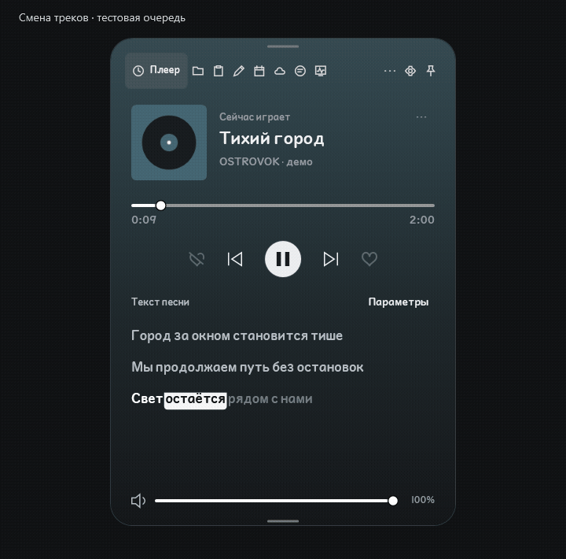

# OSTROVOK

[GitHub](https://github.com/rapichmoney) · [Написать мне](https://t.me/rapichmoney) · [Telegram-канал](https://t.me/rapichlinkmoney)

Dynamic Island как на iPhone — на компьютере с Windows. Бесплатно и с открытым исходным кодом.

OSTROVOK собирает музыку, текст песни и уведомления в небольшом острове у края экрана. Он раскрывается, когда нужны элементы управления, и сворачивается, когда вы возвращаетесь к работе.



[Скриншоты, текст песни и уведомления в движении](docs/SHOWCASE.md)

## Обновление 1.0.23

Нижняя подпись настроек помещается на обеих гарнитурах. Добавлены локальный журнал работы и отдельные отчёты о сбоях. Открыть их можно через **Настройки → Система → Журнал и сбои → Открыть папку журналов**.

Файлы хранятся в `%LOCALAPPDATA%\DesktopIsland\Logs`, отчёты — в `Logs\Crashes`. Порог ротации журнала — 1 МБ; сохраняются 14 файлов журнала и 30 последних отчётов. Отчёт содержит версию, тип исключения, код ошибки и стек вызовов; содержимое буфера, сообщений и песен, токены и дампы памяти не записываются. Автоотправки нет.

## Обновление 1.0.22

Исправлен значок панели задач Windows и переход Read Along между словами. Метки начала и окончания слова сохраняют паузы: плашка гаснет, а уже прочитанный текст остаётся видимым. Большой плеер и мини-остров используют одинаковые времена слов.

Если источник передал только таймкоды строк, подсветка слов остаётся приблизительной. Текущий режим указан в **Настройки → Музыка**.

[Read Along с демонстрационными паузами](docs/media/v1.0.22/read-along-compact.gif) · [В раскрытом плеере](docs/media/v1.0.22/read-along-expanded.gif)

## Обновление 1.0.21

В плеере остались обложка, трек, управление и строки песни. Поиск текста, LRC и выбор источника перенесены в **Настройки → Музыка**. Настройки открываются поверх острова, используют стандартные кнопки окна Windows и плавно меняют цвета вместе с обложкой.

В **Настройки → Погода** можно добавить несколько городов и менять их порядок стрелками. Первый город используется в мини-острове, а сводки по всем сохранённым городам доступны во вкладке погоды. Выбранный ранее город переносится в список автоматически.

В прогнозе для каждой даты отображается её погода: движущиеся облака, капли дождя, снежинки или солнце. Анимация работает только в открытой вкладке. При включённом режиме «Меньше анимаций» изображения статичны.



## Обновление 1.0.20

Сворачивание без наложения двух копий плеера:



Обновления GitHub теперь можно устанавливать из острова. Демонстрация уведомления с тестовым номером версии:


## Обновление 1.0.18 в движении

Записи из интерфейса приложения с тестовыми треками, обложками и метками слов. Личные данные в записи не используются.

Read Along в мини-острове:


Read Along в раскрытом плеере:



Смена треков, включая несколько быстрых переключений:



[Сворачивание острова в 1.0.20](docs/media/v1.0.20/collapse.gif) · [Все записи](docs/SHOWCASE.md)

Новые настройки: **Вкладки** — выбор разделов; **Система** — проверка подключений и заряд XInput-геймпада. Уровень заряда выводится только если его передаёт устройство. Ширину раскрытого острова можно менять за правый край, высоту — за нижний. На небольших экранах содержимое уменьшается до доступной рабочей области. При недоступном прямом звуке Яндекс Музыки ползунок явно переключается на системную громкость.

## YouTube и другие видео

Остров показывает название видео, автора и время просмотра. В Discord RPC видео отображается как просмотр с таймером. Если одновременно воспроизводится музыка, она получает приоритет; после паузы музыки остров может переключиться на играющее видео. Для видео поиск текста песни отключён. Воспроизведение из Telegram исключено из плеера и RPC.

При прямом подключении YouTube кнопка воспроизведения в острове ставит выбранное видео на паузу и возобновляет его. Если во вкладке уже открыто другое видео, команда для прежнего ролика не выполняется.

На паузе активность прослушивания или просмотра убирается из Discord. При продолжении таймер рассчитывается от текущей позиции. Если показ трека в настройках RPC отключён, остаётся общий статус приложения без названия песни.

В версии 1.0.9 переход от музыки к другому источнику подтверждается в течение 1,2 секунды. Короткие пропадания состояния плеера не должны менять выбранный источник; возобновившаяся музыка получает приоритет сразу.

Прямой адаптер YouTube без расширения использует штатное разрешение браузера на странице `browser://inspect/#remote-debugging`. Для текущего профиля включите «Allow remote debugging for this browser instance», затем выберите **«Подключить YouTube»** в меню плеера OSTROVOK (три точки рядом с треком) и подтвердите один запрос браузера. Приложение обнаруживает адрес через `DevToolsActivePort`, сохраняет соединение и обращается только к страницам видео YouTube. По полученным данным формируются обложка, автор, таймер и кнопка «Открыть видео» в RPC. Подключение к текущему профилю Яндекс Браузера 26.10.3.771 проверено; совместимость с другими версиями зависит от браузера.

При запуске OSTROVOK не подключается к отладке автоматически. После отказа, таймаута или обрыва запрос доступа не повторяется: для новой попытки снова выберите «Подключить YouTube». В том же меню можно отменить подключение или отключить YouTube. Закрытые вкладки освобождаются; ошибка отдельной вкладки не сбрасывает разрешение для всего браузера.

Старые параметры `--remote-debugging-port` и `--remote-debugging-pipe` конфликтуют с новым режимом: уберите их из ярлыка и полностью завершите все окна и фоновые процессы браузера перед повторным запуском. Закрытие одного окна может оставить прежний процесс с прежними параметрами.

Без прямого подключения остаётся резервный способ через специальные возможности Windows: заголовок открытого окна YouTube и кнопка паузы. Он не видит скрытые вкладки и не получает автора, обложку или таймер. Поддерживаются русские и английские подписи кнопок.

## Скачать и запустить

Скачайте архив OSTROVOK из [последнего релиза](https://github.com/rapichmoney/OSTROVOK/releases/latest), распакуйте его в постоянную папку и запустите `DesktopIsland.exe`. Требуется Windows 10 2004 или новее, x64. Установка .NET не требуется.

Для уведомлений Windows нужна регистрация приложения: `Package/Register.ps1`, затем доступ к уведомлениям в параметрах конфиденциальности Windows. Скрипт требует уже включённого режима разработчика; сам настройки Windows не меняет. Пакет сохраняет имя Desktop Island, чтобы обновления не сбрасывали разрешения.

## Что умеет

- Управляет воспроизведением, перемоткой и громкостью. Для Яндекс Музыки доступны лайк и дизлайк из её плеера.
- Показывает обложку, название и исполнителя. При наличии таймкодов прокручивает текст и выделяет произнесённую часть строки. Заполнение внутри строки приблизительное, если источник не передаёт время отдельных слов.
- При смене песни сразу показывает новое название и исполнителя — минимум секунду и на всё время загрузки. Затем плавно переходит к тексту; в интро и при отсутствии текста оставляет название и исполнителя.
- Даёт прокручивать текст колесом или полосой прокрутки. Ручная прокрутка сохраняет позицию; кнопка «К текущей строке» возвращает слежение.
- Показывает уведомления Windows, в том числе Telegram, и сообщает о копировании текста и файлов. Содержимое зависит от разрешений Windows и настроек отправляющего приложения.
- Переводит скопированный английский текст на русский. После успешного перевода следующее копирование русского текста включает обратный перевод на английский.
- Содержит полку файлов, заметки, задачи, календарь, погоду и показатели системы.
- Передаёт статус в Discord через локальный RPC: обложку, название, исполнителя и время трека. В настройках «Система» включите «Показывать OSTROVOK в Discord». Application ID уже встроен; при желании его можно заменить своим. Скрытие песни также убирает обложку и ссылку; буфер, заметки и уведомления не передаются.

Наведите указатель на остров для раскрытия. Двойное нажатие на вкладку плеера сворачивает его. Размер, положение, поведение, шрифт и цвет от обложки меняются в настройках.

## Перевод по двойному Ctrl+C

Выделите текст и дважды нажмите Ctrl+C с интервалом до 650 мс. Можно удерживать Ctrl и дважды нажать C. Русский текст переводится на английский, английский — на русский; предварительный перевод или триггер не нужен.

Результат заменяет исходный текст в буфере, остров показывает уведомление. Вставьте перевод через Ctrl+V. Если за время перевода вы скопировали другой текст, новый буфер не перезаписывается: результат остаётся в истории острова.

В **Настройки → Данные → Буфер обмена** можно включить **«Вставлять перевод после двойного Ctrl+C»**. По умолчанию опция выключена. При включении перевод заменяет исходное выделение в редактируемом поле. Если окно, поле, выделение или буфер изменились, автовставка отменяется и перевод остаётся для ручной вставки. В обычном автоматическом режиме перевода автовставка не выполняется.

Сочетание работает при включённом сборе буфера, в том числе при выключенном автоматическом переводе. Обычный режим перевода не изменён. Поддерживается текст до 4 000 символов; файлы и ссылки не переводятся.

## Яндекс Музыка

Для прямого управления плеером и загрузки синхронизированного текста нужен локальный отладочный порт Яндекс Музыки. Скрипт `tools/repair_yandex_connection.ps1` находит установленное приложение и запускает его с портом 9226. Остров повторно подключается при восстановлении связи. Данные аккаунта и токен Яндекса вводить не требуется.

## Сборка

Требуются Windows, .NET SDK 9 и Node.js для проверок адаптера.

```powershell
.\check.ps1
.\build.ps1
```

Сборка создаёт автономный архив в `artifacts`. Проверки используют отдельные тестовые данные. Настройки пользователя хранятся в `%LOCALAPPDATA%\DesktopIsland`.

Проект написан на C# и WPF. Это самостоятельная реализация по мотивам [Dyland](https://github.com/qxezecwry/Dyland), не связанная с его автором. Код и графика Dyland в публикацию не включены.

Код: MIT. Лицензии шрифта и библиотек перечислены в [THIRD-PARTY-NOTICES.md](THIRD-PARTY-NOTICES.md).

### Анимации и Read Along

Вкладки, меню, элементы плеера, уведомления и разделы настроек используют согласованные переходы. Повторные нажатия меняют текущий переход без сброса к начальному состоянию. Раскрытие острова сохранено.

**Read Along** включается отдельно в **Настройки → Музыка → Read Along — плашка на текущем слове**. По умолчанию он выключен: обычная подсветка строки остаётся доступной. Для текста только с таймкодами строк движение по словам приблизительное. Режим **«Меньше анимаций»** отключает движение плашки и остальные новые переходы.

Установленный лайк выделяется красным. Ползунок перемотки показывает таймкод при перетаскивании, а очередь уведомлений — число ожидающих сообщений и оставшееся время показа.

Read Along работает в раскрытом плеере и в свёрнутом острове. Enhanced LRC сохраняет метки отдельных слов. Если источник передал такие метки, плашка следует им; иначе используется приблизительное распределение времени строки. Текущий режим указан в подсказке. Дополнительный сдвиг слов задаётся в настройках музыки. Нейромодели, микрофон и захват звука для этого режима не используются.

### Обновления из острова

Начиная с 1.0.20, приложение проверяет стабильные релизы GitHub и показывает уведомление с кнопками **«Обновить»** и **«Позже»**. По кнопке архив скачивается, проверяются размер, SHA-256 и версия EXE. Затем приложение закрывается, файлы заменяются и OSTROVOK запускается снова. При ошибке замены предыдущие файлы восстанавливаются из резервной копии; настройки в `%LOCALAPPDATA%\DesktopIsland` сохраняются.

Проверка работает раз в четыре часа. В **Настройки → Система → Обновления** можно проверить вручную или отключить проверку. Обновление устанавливается только по нажатию кнопки. Папка приложения должна быть доступна для записи; файлы предыдущей версии сохраняются в `%LOCALAPPDATA%\DesktopIsland\Updates`.
