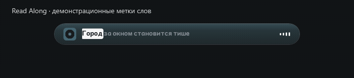
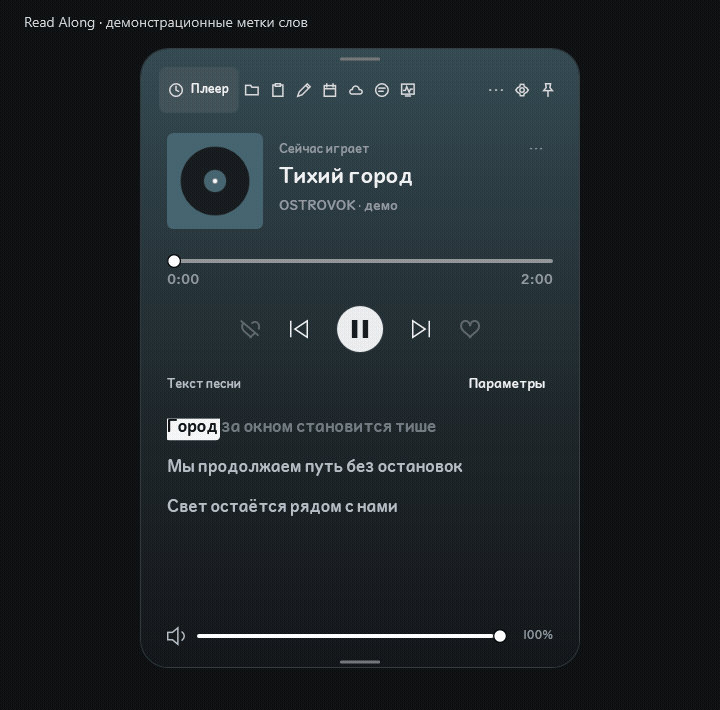
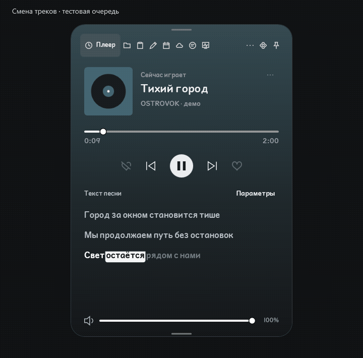

# OSTROVOK 1.0.18

- Исправлены поиск кнопок лайка и дизлайка в разных вариантах панели Яндекс Музыки и обновление доступности сразу после подключения. Оценка выполняется только кнопкой текущего трека.
- Если прямое управление звуком Яндекс Музыки недоступно, ползунок переключается на системную громкость и сообщает об этом в подсказке. Проверяется действующее устройство вывода Windows.
- Убрано появление «От сети» на компьютерах без батареи: вместо этого остаётся дата.
- Содержимое острова подстраивается под рабочую область экрана. Ширина раскрытого острова меняется за правый край, высота — за нижний; края мини-острова также растягиваются.
- В настройках появился раздел **«Вкладки»**. Можно скрыть ненужные разделы, сохранив их данные. Плеер и настройки доступны всегда.
- В разделе **«Система»** добавлены проверка подключений и переключатель заряда XInput-геймпада. Заряд показывается только при наличии данных от устройства, без выдуманных процентов.
- При первом запуске проверяются подключения и показывается статус. Доступ к уведомлениям остаётся под контролем Windows; запрос разрешения не повторяется при каждом запуске. Браузер автоматически не перезапускается.
- При скрытии через Ctrl+Alt+Space свечение убирается сразу. При сворачивании сохраняется исходящий кадр содержимого, чтобы панель не обнулялась до завершения перехода.

GIF ниже записаны с реальных элементов WPF в изолированном режиме демонстрации. Используются тестовые треки и метки слов. Для песен без меток слов Read Along остаётся приблизительным.

[Записи и сворачивание](https://github.com/rapichmoney/OSTROVOK/blob/main/docs/SHOWCASE.md)

Скачайте **OSTROVOK-1.0.18-win-x64.zip**, распакуйте и запустите `DesktopIsland.exe`. Перед заменой файлов закройте предыдущую версию. Windows 10 2004 или новее, x64; .NET включён в архив.
