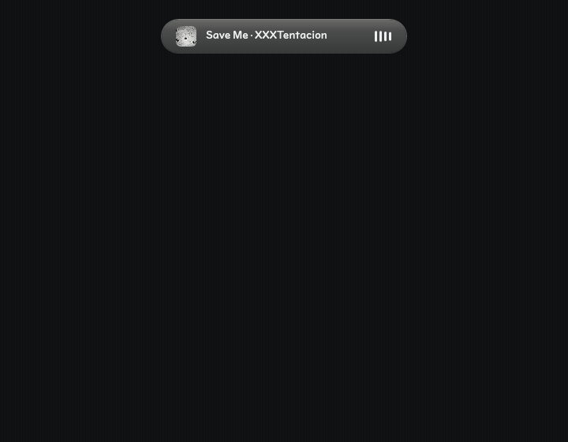
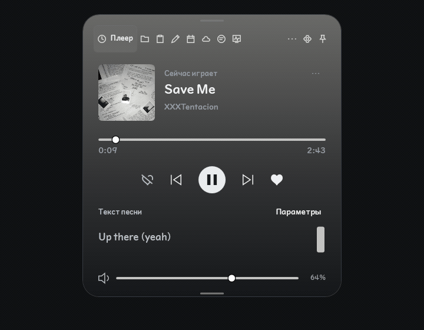
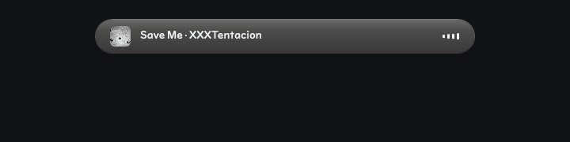
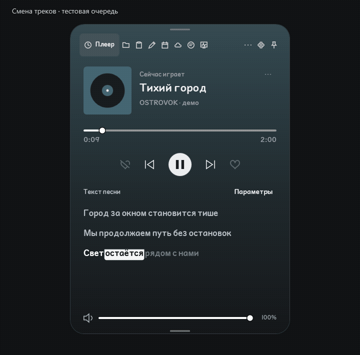
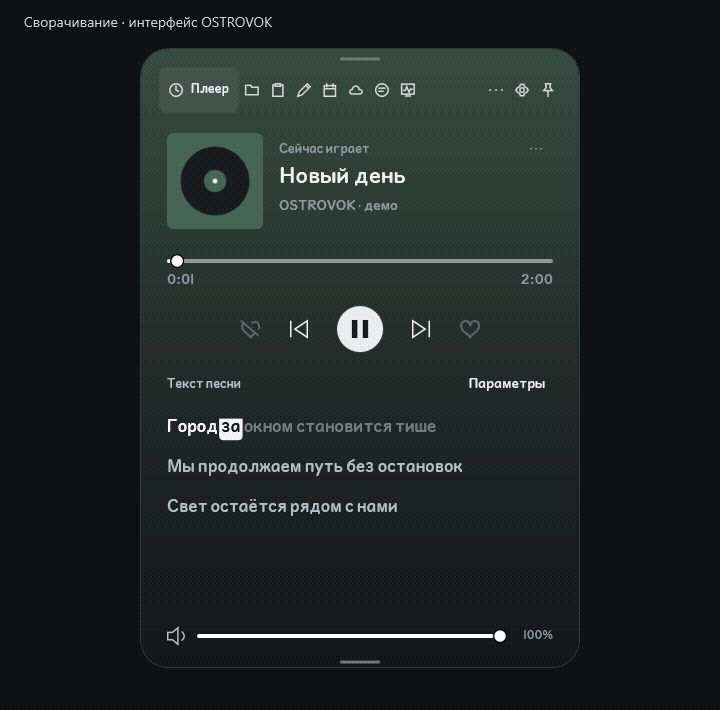

# OSTROVOK в работе

Записано в самом приложении с треком **XXXTentacion — Save Me**, обложкой альбома *17* и коротким фрагментом текста. Уведомление тестовое; личные сообщения и буфер обмена в записи не используются.

## Раскрытие острова

## Текст песни

## Уведомление

## Скриншоты

Состояние покоя:

Компактный плеер:

Раскрытый плеер:

Уведомление:

## Повторить запись

После сборки запустите `DesktopIsland.exe --showcase --output <папка>`. Режим использует отдельное временное хранилище и демонстрационные данные, создаёт PNG и последовательности кадров с частотой 25 кадров в секунду. Видеокадры записываются из WPF, без захвата рабочего стола.

Для записи с Save Me добавьте `--showcase-track docs/media/showcase-track.json`. Метаданные и обложка получены из подключённого плеера; время короткого фрагмента сверено с LRCLIB. Запись не управляет воспроизведением музыки.

## Обновление 1.0.18

Эти GIF записаны с WPF-элементов текущей сборки в изолированном режиме демонстрации. Треки, изображения пластинок и строки созданы для записи; время отдельных слов задано в тестовых данных. Это показ движения интерфейса, а не подтверждение наличия меток слов у всех песен.

### Read Along в мини-острове

### Read Along в раскрытом плеере

### Быстрые переключения треков

### Сворачивание

