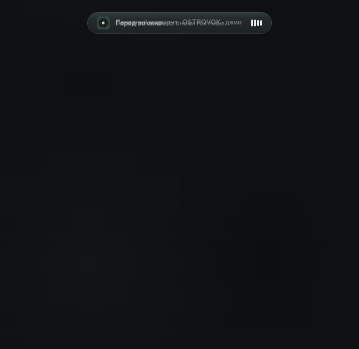
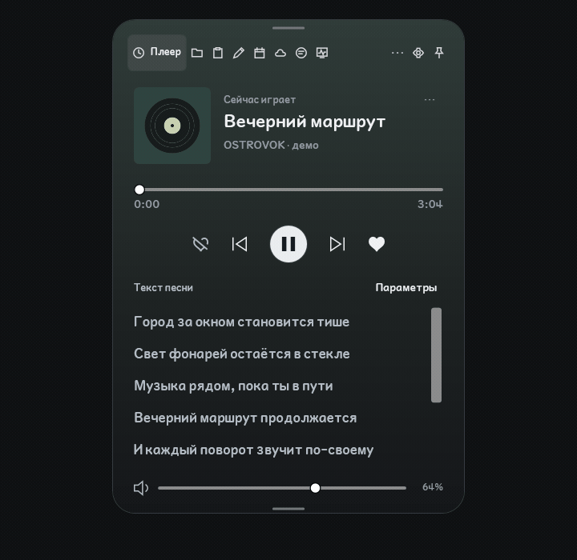
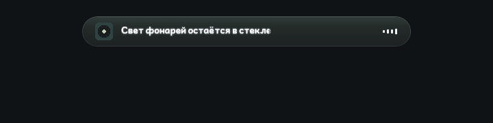
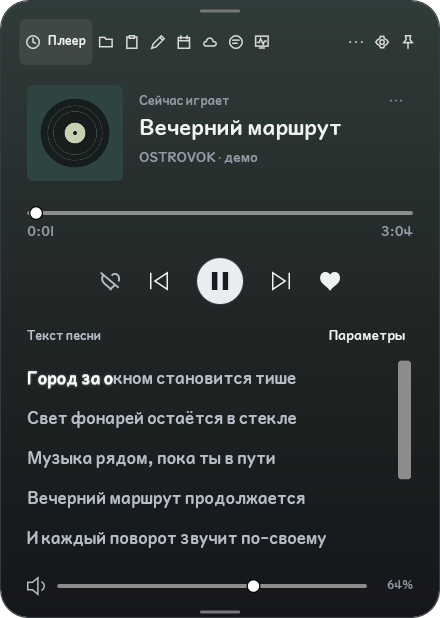

# OSTROVOK в работе

Записано в самом приложении. Трек, обложка, строки песни и сообщение — демонстрационные; личные данные в записи не используются.

## Раскрытие острова

## Текст песни

## Уведомление

## Скриншоты

Состояние покоя:

Компактный плеер:

Раскрытый плеер:

Уведомление:

## Повторить запись

После сборки запустите `DesktopIsland.exe --showcase --output <папка>`. Режим использует отдельное временное хранилище и демонстрационные данные, создаёт PNG и последовательности кадров с частотой 25 кадров в секунду. Видеокадры записываются из WPF, без захвата рабочего стола.
